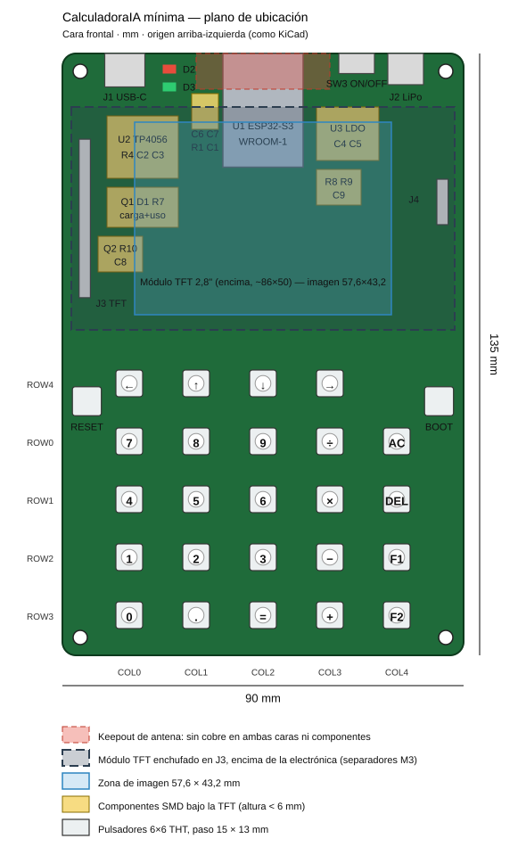

# Especificación de PCB — CalculadoraIA MÍNIMA (fase 1)

Placa de prueba **compacta** (no entra en la carcasa de la Casio): ESP32-S3-WROOM-1 soldado,
TFT 2,8" enchufada encima, 24 pulsadores 6×6, LiPo con carga USB-C. Mismos pines que la fase 0
(DevKitC), así que el firmware es el mismo: `pio run -e pcb`.

## Archivos (`hardware/`)
- `guia_conexiones_minima.md` — esquemático bloque por bloque (redes y etiquetas).
- `BOM_minima.csv` — materiales con huella KiCad sugerida.
- `contorno_minima.dxf` — contorno 90 × 135 mm, esquinas r3. **Importar a Edge.Cuts.**
- `floorplan_minima.svg` — plano de ubicación.

## Reglas de fabricación
| Parámetro | Valor |
|---|---|
| Capas | 2 |
| Espesor / cobre | 1,6 mm FR4 / 1 oz |
| Acabado | **HASL** alcanza (con pulsadores no hace falta ENIG) |
| Pista mín. / separación mín. | 0,20 mm / 0,20 mm |
| Pistas de potencia | `+5V`, `VSYS`, `VBAT`, `+3V3`: 0,5–0,8 mm |
| Vía mín. | 0,3 mm de perforación / 0,6 mm de pad |
| Máscara / serigrafía | ambas caras |

## Contorno y montaje (mm, origen **arriba-izquierda**, Y hacia abajo como en KiCad)
- Placa **90 × 135**, esquinas de radio 3.
- Agujeros M3 (Ø3,2): **(4, 4) · (86, 4) · (4, 131) · (86, 131)**.
- Módulo TFT: unos 86 × 50 mm, sobre la zona **x 2–88, y 12–62**, enchufado en J3 y fijado con
  separadores M3 en sus 4 agujeros. **Mide el módulo real** (agujeros y posición del header)
  y ubica J3 y los 4 agujeros de los separadores con esas medidas.

## Ubicación (todo en la cara frontal)

| Zona | Qué va | Posición aprox. |
|---|---|---|
| Franja superior (visible, y 0–12) | J1 USB-C (borde) · D2/D3 LEDs · SW3 ON/OFF (borde) · J2 LiPo (borde) | J1 x≈14 · LEDs x≈24 · SW3 x≈66 · J2 x≈77 |
| **Keepout de antena** | **sin cobre en ninguna cara, sin componentes** | x 30–60, y 0–8 |
| Bajo la TFT (componentes < 6 mm) | U1 ESP32 (antena hacia arriba, al ras del borde) | x 36–54, y 0–25,5 |
| | U2 TP4056 + R4, C2, C3 · Q1, D1, R7 | izquierda, x 10–26, y 14–39 |
| | U3 LDO + C4, C5 · R8, R9, C9 | derecha, x 57–71, y 12–34 |
| | C6, C7 (**pegados al pin 3V3**), R1, C1 | junto al lado izquierdo de U1 |
| | Q2, R10, C8 cerca de J3 · J4 UART | J3 en x≈5 (vertical, centrado en y≈37) · J4 en x≈85 |
| Teclado (y 71–129) | SW10–SW33, paso **15 × 13** | columnas x = 15, 30, 45, 60, 75 · filas y = 74, 87, 100, 113, 126 |
| Laterales del teclado | SW1 RESET (izq.) · SW2 BOOT (der.) | (5,5 ; 78) · (84,5 ; 78) |

Filas físicas de arriba a abajo: **← ↑ ↓ →** (ROW4) · 7 8 9 ÷ AC (ROW0) · 4 5 6 × DEL (ROW1) ·
1 2 3 − F1 (ROW2) · 0 . = + F2 (ROW3). Serigrafía con el nombre de cada tecla junto al pulsador.

## Ruteo
1. **Antena:** respeta el keepout. La TFT empieza en y = 12, a unos 4 mm de la antena; si el WiFi
   llega débil, baja la TFT unos milímetros.
2. **Desacoplo:** C6 (22 µF) + C7 (100 nF) a menos de 3 mm del pin 2 (3V3) de U1, con vía a GND directa.
3. **USB D+/D−:** par corto y paralelo de J1 a IO19/IO20 (pines 13/14 de U1). Es USB full-speed: no hace falta impedancia controlada.
4. **Teclado:** filas `ROW0–4` horizontales en **F.Cu** y columnas `COL0–4` verticales en **B.Cu**;
   suben hasta los pines 4–12 y 17 de U1 (lado izquierdo y abajo del módulo).
5. **TFT:** `TFT_CS/MOSI/SCK/DC/RST/BL` salen de los pines 18–23 (abajo de U1) hacia J3 a la izquierda.
6. **TP4056:** pad expuesto soldado a un plano GND con varias vías (disipa el calor de la carga).
7. **Planos GND** en ambas caras (fuera del keepout), unidos con vías cada ~10 mm.
8. **DRC** limpio antes de exportar.

## Exportar para fabricar
Gerbers (F.Cu, B.Cu, F/B.Mask, F/B.SilkS, F/B.Paste, Edge.Cuts) + taladros Excellon.
Nota para el fabricante: **2 capas, 1,6 mm, HASL, máscara verde/negra**.

## Primer encendido (orden sugerido)
1. Soldar **solo la potencia** (J1, U2, Q1, D1, SW3, U3 y sus pasivos). Con USB: medir `VSYS` ≈ 4,6 V
   y `+3V3` = 3,3 V. Conectar la batería: el LED rojo enciende mientras carga.
2. Soldar U1 + EN/BOOT + C6/C7. Conectar USB: debe aparecer como puerto serie
   (si no, mantener BOOT, pulsar RESET y soltar BOOT).
3. Subir `pio run -e pcb -t upload`, soldar J3, enchufar la TFT y luego los pulsadores.

## Decisiones (2026-10-13)
- **M-007** PCB de prueba **compacta 90 × 135 mm**, todo en la cara frontal y la TFT enchufada encima.
- **M-008** **ESP32-S3-WROOM-1 N16R8 soldado** + USB-C nativo (sin conversor USB-serie).
- **M-009** **Carga con la placa encendida** (Q1 + D1): con USB conectado el sistema se alimenta del USB
  y el TP4056 carga la batería sin carga en paralelo.
- **M-010** Retroiluminación por **P-MOSFET Q2** (activa en LOW) → entorno de firmware `pcb`.
- **M-011** Flechas reordenadas a **← ↑ ↓ →** en la fila ROW4 (cambio solo de firmware y serigrafía).
