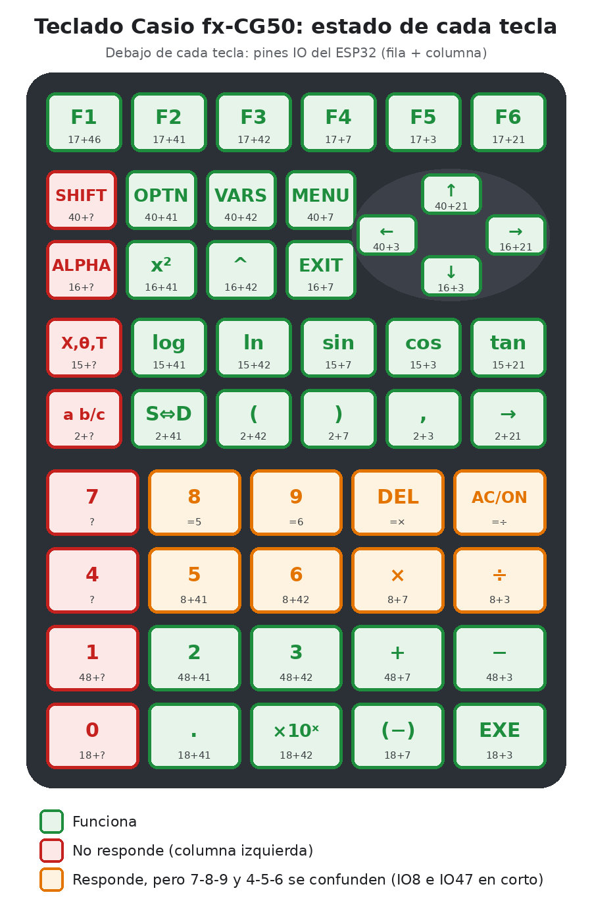

# Mapa del teclado original de la Casio fx-CG50 (CN701 → DevKit)

Medido el 2026-10-14 con `firmware/arduino/casio_asignar`. El cable plano del conector CN701 va
directo a los pines del DevKit. Cada tecla une una **fila** con una **columna**.



## Matriz

| Fila \ Columna | IO46 | IO41 | IO42 | IO7 | IO3 | IO21 |
|---|---|---|---|---|---|---|
| **IO17** | F1 | F2 | F3 | F4 | F5 | F6 |
| **IO40** | *(SHIFT?)* | OPTN | VARS | MENU | ← | ↑ |
| **IO16** | *(ALPHA?)* | x² | ^ | EXIT | ↓ | → |
| **IO15** | *(X,θ,T?)* | log | ln | sin | cos | tan |
| **IO2** | *(fracción?)* | S⇔D | ( | ) | , | → (asignar) |
| **IO8 / IO47** | *(4? 7?)* | 5 | 6 | × | ÷ | |
| **IO48** | *(1?)* | 2 | 3 | + | − | |
| **IO18** | *(0?)* | . | ×10^x | (−) | EXE | |

*En cursiva:* teclas que no respondieron.

## Tabla para el firmware (38 teclas confirmadas)

```cpp
const KeyName KEYS[] = {
  {"IO17", "IO46", "F1"},   {"IO17", "IO41", "F2"},  {"IO17", "IO42", "F3"},
  {"IO7", "IO17", "F4"},    {"IO3", "IO17", "F5"},   {"IO17", "IO21", "F6"},
  {"IO40", "IO41", "OPTN"}, {"IO40", "IO42", "VARS"}, {"IO7", "IO40", "MENU"},
  {"IO3", "IO40", "IZQUIERDA"}, {"IO21", "IO40", "ARRIBA"},
  {"IO3", "IO16", "ABAJO"},     {"IO16", "IO21", "DERECHA"},
  {"IO16", "IO41", "x^2"},  {"IO16", "IO42", "^"},   {"IO7", "IO16", "EXIT"},
  {"IO15", "IO41", "log"},  {"IO15", "IO42", "ln"},  {"IO7", "IO15", "sin"},
  {"IO3", "IO15", "cos"},   {"IO15", "IO21", "tan"},
  {"IO2", "IO41", "S<>D"},  {"IO2", "IO42", "("},    {"IO2", "IO7", ")"},
  {"IO2", "IO3", "coma"},   {"IO2", "IO21", "->"},
  {"IO8", "IO41", "5"},     {"IO8", "IO42", "6"},    {"IO7", "IO8", "x"},
  {"IO3", "IO8", "/"},
  {"IO41", "IO48", "2"},    {"IO42", "IO48", "3"},   {"IO7", "IO48", "+"},
  {"IO3", "IO48", "-"},
  {"IO18", "IO41", "."},    {"IO18", "IO42", "x10^x"}, {"IO7", "IO18", "(-)"},
  {"IO3", "IO18", "EXE"},
  {nullptr, nullptr, nullptr},
};
```

## Pendiente

1. **IO8 e IO47 están unidos siempre.** Las filas 7-8-9-DEL-AC y 4-5-6-×-÷ salen iguales
   (al presionar 8 aparece lo mismo que con 5). Hay que buscar un puente de estaño entre esos dos
   cables en las soldaduras de CN701.
2. **Columna de la izquierda** (SHIFT, ALPHA, X,θ,T, fracción, 7, 4, 1, 0): no responde salvo F1.
   Se detectaron 20 de los 21 cables. Probablemente el que falta no está en un pin leído o no hace
   contacto.
3. `IO5`, `IO6` e `IO38` están unidos siempre: deben ser los GND/VCC de la Casio. Es normal.
4. Pares que aparecen al presionar dos teclas a la vez (no son teclas): `IO15+IO16`, `IO16+IO40`,
   `IO2+IO15`, `IO3+IO7`, `IO3+IO42`, `IO7+IO41`, `IO7+IO42`, `IO2+IO8`, `IO1+IO2`.
   `IO1+IO42` e `IO20+IO46` salieron pocas veces: revisar.
